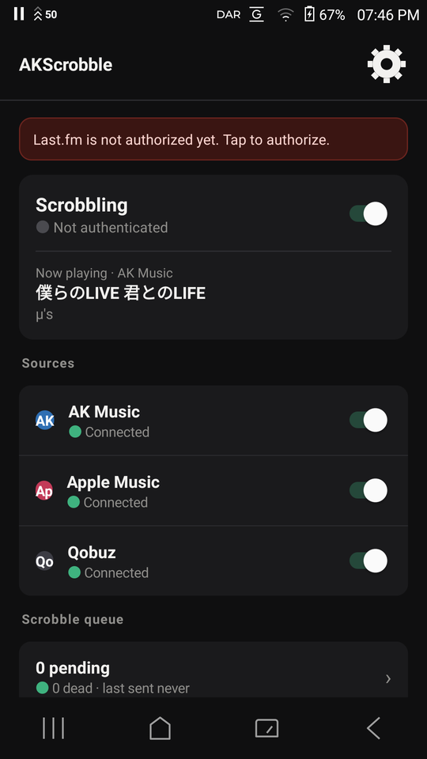
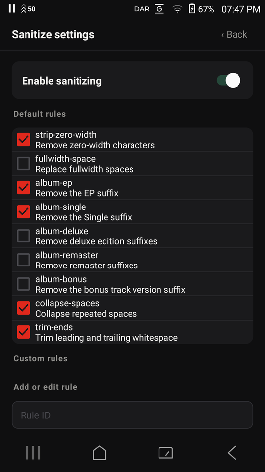
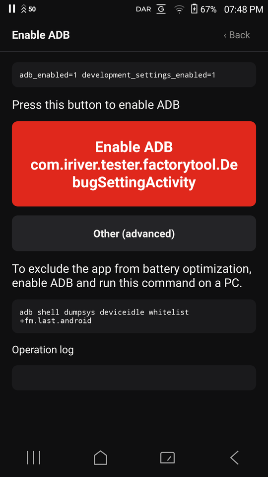
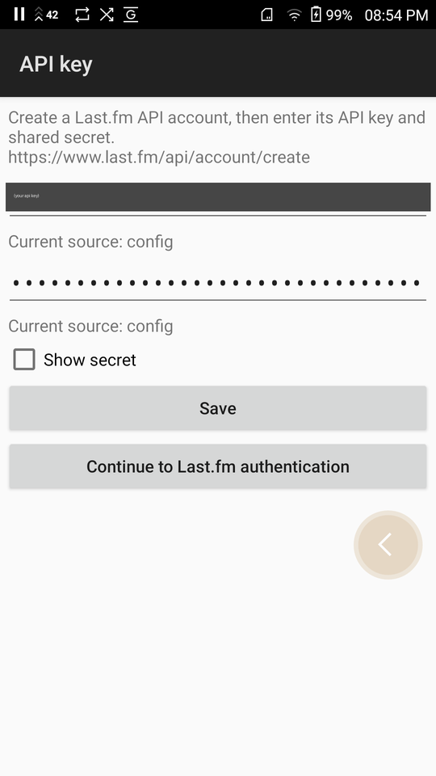

[English](README.md) | [日本語](README.ja.md) | [한국어](README.ko.md)

# AKScrobble

> 이 한국어 번역은 기계 번역 수준이며 아직 검토되지 않았습니다. 수정 Pull Request를 환영합니다.

## 소개

AKScrobble은 Astell&Kern 디지털 오디오 플레이어용 Last.fm 스크로블러입니다.
Android 9을 실행하는 A&ultima SP2000T에서 테스트했으며, 다른 Astell&Kern 모델은
테스트하지 않았습니다.

**root 권한이 필요하지 않습니다.** 설치부터 스크로블까지 모두 순정 기기에서
동작합니다. 배터리 최적화 명령 하나를 위해 ADB를 활성화해야 하지만, 그것도 앱
안에서 할 수 있습니다.

이 앱은 기기 펌웨어의 설치 제한을 충족하기 위해 패키지 이름 `fm.last.android`를
사용합니다. 이에 따른 영향은 [알려진 제한 사항](#알려진-제한-사항)을 참조하세요.

| 메인 화면 | 문자열 정리 설정 | ADB 활성화 |
|---|---|---|
|  |  |  |

스크린샷은 SP2000T에서 표시 언어를 영어로 설정한 화면입니다.

## 지원 플레이어

다음 플레이어에서 작동을 확인했습니다.

- AK Music (`com.iriver.ak.music`)
- Apple Music (`com.apple.android.music`)

Amazon Music (`com.amazon.mp3`)은 `onGetRoot` 메서드가 `null`을 반환하므로 연결할 수
없습니다. Spotify와 Qobuz는 테스트되지 않았으며 현재 지원하지 않습니다. 이 앱들이나
다른 플레이어 지원이 필요하면 [issue를 열어](https://github.com/kakeru-ikeda/akscrobble/issues)
주세요. 수요에 따라 지원을 검토할 수 있습니다.

## 준비물

- Last.fm 계정
- [API 계정 생성 페이지](https://www.last.fm/api/account/create)에서 발급받은
  Last.fm API 키와 secret. **Callback URL**과 **Application homepage**는 비워 두어도
  됩니다. AKScrobble은 둘 다 사용하지 않습니다
- MTP로 플레이어에 연결할 수 있는 컴퓨터

`adb`는 배터리 최적화 명령 하나에만 필요합니다. 그 밖의 설정은 모두 플레이어에서
또는 MTP 저장소를 통해 수행합니다.

## 설치 (처음부터 스크로블링까지)

1. [GitHub Releases](https://github.com/kakeru-ikeda/akscrobble/releases)에서
   `akscrobble-<version>.xapk`를 다운로드합니다.
2. 플레이어를 MTP로 컴퓨터에 연결합니다. 파일을 복사하기 전에 `OpenService` 폴더에서
   이전 `.xapk` 파일과 플레이어가 이전에 압축을 푼 폴더를 모두 삭제하세요. 남은 파일은
   중복 항목과 이름 충돌을 일으킬 수 있습니다.
3. 다운로드한 `.xapk` 파일을 `OpenService` 폴더에 복사합니다.
4. 플레이어에서 OpenService를 열고 목록에서 AKScrobble을 설치합니다.
   OpenService로 설치할 수 있는 앱은 최대 4개입니다. 이미 4개가 설치되어 있다면
   하나를 제거한 뒤 AKScrobble을 설치하세요.
5. AKScrobble을 실행하고 위쪽 버튼으로 언어를 선택합니다.
6. 저장소 권한을 허용합니다. AKScrobble이 MediaStore에서 AK Music 앨범 이름을
   가져오는 데 필요합니다.
7. Last.fm API 계정을 만들고 자격 증명을 AKScrobble에 전달합니다. 방법은 두 가지가
   있지만 **설정 파일이 훨씬 편합니다**. 32자리 키를 플레이어의 화면 키보드로 입력하는
   것은 상당히 번거롭기 때문입니다.

   **권장: 설정 파일.** 앱을 한 번 실행하면 내부 저장소에
   `AKScrobble/config.properties`가 만들어집니다. MTP로 열어 두 값을 채우세요.

   ```properties
   api_key=발급받은 api_key
   api_secret=발급받은 api_secret
   ```

   그런 다음 메인 화면에서 **설정 파일 불러오기**를 누르세요. `session_key`는 비워
   두세요(인증 과정에서 앱이 받아 저장합니다). 이 파일의 값은 앱에서 입력한 값보다
   우선합니다.

   반영되었는지는 메인 화면 아래의 상태 표시로 확인합니다. `api_key source:`가
   `config`가 되고, 8단계 이후 `auth:`에 Last.fm 사용자 이름이 나오면 성공입니다.
   `api_key source:`가 계속 `unset`이면 파일을 읽지 못한 것이므로 경로와 철자를
   확인한 뒤 **설정 파일 불러오기**를 다시 누르세요.

   **대체: 앱에서 직접 입력.** **API 키**를 열고 두 값을 붙여 넣은 뒤 저장합니다.
   각 필드에 현재 어디에서 값을 가져오는지 표시되므로 의도한 값이 쓰이는지 확인할 수
   있습니다.

   

8. **Last.fm 인증**을 탭하고 WebView에서 접근을 승인하여 앱이 세션을 받도록 합니다.
9. **서비스 시작**을 탭합니다.
10. AKScrobble을 배터리 최적화에서 제외합니다. 컴퓨터가 필요한 유일한 단계입니다.
    앱에서 **ADB 활성화**를 열고 강조 표시된 `DebugSettingActivity` 버튼을 탭하여
    ADB를 활성화합니다. 컴퓨터에서 플레이어가 `adb devices`에 표시되는지 확인한 후
    다음을 실행합니다.

    ```sh
    adb shell dumpsys deviceidle whitelist +fm.last.android
    ```

플레이어에서 `.apk`를 직접 열지 마세요. Astell&Kern은 해당 설치 경로를 비활성화하므로
항상 패키지 구문 분석 오류가 발생합니다. 위의 OpenService `.xapk` 절차를 사용하세요.

## 문자열 정리 규칙

AKScrobble은 메타데이터를 표시하고 대기열에 넣어 Last.fm으로 보내기 전에 정리할 수
있습니다. 기본 제공 규칙은 다음과 같습니다.

| 규칙 ID | 범위 | 기본값 | 효과 |
| --- | --- | --- | --- |
| `strip-zero-width` | ALL | ON | 폭이 0인 문자를 제거합니다. |
| `fullwidth-space` | ALL | OFF | 전각 공백을 일반 공백으로 바꿉니다. |
| `album-ep` | ALBUM | ON | 끝의 ` - EP`를 제거합니다. |
| `album-single` | ALBUM | ON | 끝의 ` - Single`을 제거합니다. |
| `album-deluxe` | ALBUM | OFF | 끝의 괄호로 묶인 Deluxe edition 레이블을 제거합니다. |
| `album-remaster` | ALBUM | OFF | 끝의 괄호로 묶인 remaster 레이블을 제거하며, 연도나 `Version`이 포함된 경우도 처리합니다. |
| `album-bonus` | ALBUM | OFF | 끝의 `(Bonus Track Version)`을 제거합니다. |
| `collapse-spaces` | ALL | ON | 반복되는 공백이나 탭을 공백 하나로 합칩니다. |
| `trim-ends` | ALL | ON | 앞뒤 공백을 제거합니다. |

**문자열 정리 설정**을 열어 기본 제공 규칙을 활성화하거나 비활성화할 수 있습니다.
사용자 지정 규칙을 추가하려면 고유 ID를 지정하고 범위(`ALL`, `TRACK`, `ARTIST`,
`ALBUM` 또는 `ALBUM_ARTIST`)를 선택한 뒤 정규식과 치환 문자열을 입력하고 저장합니다.
규칙을 실제로 사용하기 전에 미리 보기 필드에서 샘플 메타데이터를 시험하고 각 변경
결과를 확인하세요.

안전 조치로, 치환 결과가 공백으로만 이루어진 값이 되면 AKScrobble은 원래 값을 유지합니다.

## 스크로블링 작동 방식 (개발자용)

AKScrobble은 권한 없이 `MediaBrowser`를 사용하여 각 대상 앱의 `MediaBrowserService`에
연결하고 `MediaController`를 통해 메타데이터와 재생 상태 업데이트를 구독합니다. AK
펌웨어가 내부 상태를 통해 거부하고 우회하려면 root 접근이 필요한
`NotificationListenerService`는 사용하지 않습니다. 권한 있는 접근이 필요한
`MediaSessionManager.getActiveSessions()`도 사용하지 않습니다.

재생 시간은 `PlaybackState.position`을 신뢰하지 않고 단조 시계를 기준으로 누적합니다.
AK Music은 세션이 활성화된 직후 `position = -1`을 보고할 수 있기 때문입니다. 트랙은
재생 시간의 50% 또는 4분(`Const.SCROBBLE_CAP_MS`) 중 먼저 도달한 시점에 스크로블됩니다.
30초보다 짧은 트랙(`Const.SCROBBLE_MIN_DURATION_MS`)은 스크로블되지 않습니다.

AK Music은 메타데이터에서 앨범 이름을 생략하므로 AKScrobble은 MediaStore에서 이를
확인합니다. MediaStore가 반환한 리터럴 `<unknown>`은 `null`로 변환됩니다. 그렇지 않으면
Last.fm이 ignored code 1로 전체 스크로블을 거부합니다. 메타데이터는 SQLite 대기열에
들어가기 전에 정리됩니다. 네트워크 연결이 복구될 때와 5분마다 대기열을 전송합니다.
일시적인 실패는 백오프를 적용해 재시도하고, 영구적으로 거부된 항목은 `dead`로 표시합니다.

플레이어를 추가하려면 `scrobbler/src/com/akscrobble/core/Const.java`의 `TARGETS`에
`{package name, fully qualified MediaBrowserService class name}`을 추가합니다. 서비스
이름은 다음 명령으로 찾습니다.

```sh
adb shell dumpsys package <package>
```

대상 앱의 `onGetRoot`가 연결을 허용할 때만 작동하며 Amazon Music은 연결을 거부합니다.
지원하지 않는 앱을 로컬에서 작동시켰다면 [issue를 열거나](https://github.com/kakeru-ikeda/akscrobble/issues)
[Pull Request](https://github.com/kakeru-ikeda/akscrobble/pulls)를 보내 주세요.

## 문제 해결

### 설치 목록에 AKScrobble이 표시되지 않음

플레이어의 `OpenService` 폴더에 이전 `.xapk` 파일이나 플레이어가 전에 압축을 푼 폴더가
있는지 확인하세요. 남은 파일과 폴더를 삭제하고 현재 `.xapk`만 폴더에 복사한 뒤
OpenService를 다시 여세요.

### 패키지를 파싱하는 중 문제가 발생했다는 메시지가 표시됨

`.apk`를 직접 열려고 했는지 확인하세요. AK 펌웨어는 해당 설치 경로를 비활성화합니다.
릴리스의 `.xapk`를 다운로드하고 위에서 설명한 대로 OpenService를 통해 설치하세요.

### Last.fm 인증 실패

**API 키**를 열고 각 필드에 표시된 출처 줄을 확인하세요. 자격 증명은 필드마다 `config`,
`prefs`, `builtin` 순서로 결정됩니다. `/storage/emulated/0/AKScrobble/config.properties`의
비어 있지 않은 `api_key` 또는 `api_secret`은 앱에서 입력한 값을 덮어씁니다. 저장한 값이
적용되지 않는 것 같으면 출처 줄로 이를 확인하고 해당 파일의 속성을 비우거나 삭제한 뒤
인증을 다시 시도하세요. 두 자격 증명이 같은 Last.fm API 계정의 것인지도 확인하세요.

### 트랙이 스크로블되지 않음

앱을 열어 서비스 상태, 현재 트랙, 경과 시간, 지원 플레이어, 네트워크 연결, 배터리 최적화
제외 여부를 확인하세요. 30초 미만 트랙은 의도적으로 건너뜁니다. 현재 트랙이 전혀 표시되지
않으면 지원 플레이어를 사용 중인지 확인하고 서비스를 다시 시작하세요.

더 자세한 상태를 기록하려면 **진단 덤프 저장**을 탭하세요. AKScrobble은 `STATUS`, `PREFS`,
`QUEUE`, `DEVICE` 섹션이 포함된 `/storage/emulated/0/AKScrobble/diag-*.txt`를 기록합니다.
`PREFS`의 `session_key`와 `api_secret` 값은 `***`로 마스킹됩니다. issue에 첨부하기 전에
파일을 검토하세요.

### 대기열 항목이 dead 상태가 됨

**대기열 보기**를 열고 기록된 오류를 확인하세요. `dead` 항목은 일시적인 네트워크 장애로
지연된 것이 아니라 영구적으로 거부된 항목입니다. 오류에 따라 잘못된 자격 증명이나
메타데이터를 수정한 뒤 대기열 화면에서 dead 항목을 재시도하거나 삭제하세요. 문제를
보고할 때 진단 덤프로 대기열 개수와 주변 상태를 확인할 수 있습니다.

## 소스에서 빌드

```sh
./tools/fetch_sdk.sh                                   # installs Android SDK under tools/android-sdk/
./build/build_scrobbler.sh fm.last.android 1 out.apk   # base APK
./build/make_release.sh 1 0.1.0                        # apk + xapk under artifacts/release/
./verify/run_all.sh                                    # unit tests + APK/XAPK constraint checks
```

배포 산출물은 명시적으로 지정한 키로 서명해야 합니다. `tools/env.sh`가
대체값으로 사용하는 개발용 키스토어는 비밀번호가 이 저장소에 포함되어 있으므로
배포물 서명에 사용해서는 안 됩니다. 릴리스 키는 한 번만 만들고 계속 같은 것을
사용하세요. 빌드할 때 다음 두 변수를 설정합니다.

```sh
export AKS_KEYSTORE=/secure/path/akscrobble-release.keystore
export AKS_KS_PASS='<릴리스 키스토어 비밀번호>'
./build/make_release.sh 20 1.0.0
```

`make_release.sh`는 둘 중 하나라도 설정되지 않으면 실행을 거부하고, 키스토어가
아직 없으면 생성용 `keytool` 명령을 출력합니다. 나중에 서명 키를 바꾸면 이미
설치한 사용자가 업데이트할 수 없게 됩니다.


빌드에는 Gradle이나 Android Studio를 사용하지 않습니다. 스크립트가 `aapt2`, `javac`, `d8`,
`zipalign`, `apksigner`를 직접 호출하며 앱에는 `res/` 디렉터리가 없습니다. AK 펌웨어는
v3 서명을 허용하지 않으므로 APK는 v1과 v2 서명만 사용합니다.

로컬 빌드에 API 자격 증명을 포함하려면 `build/secrets.env.example`을
`build/secrets.env`로 복사하고 값을 입력하세요. 릴리스 빌드는 의도적으로 이 파일을
우회하며 API 키나 secret을 포함하지 않습니다.

## 알려진 제한 사항

- AK 펌웨어의 설치 허용 목록에는 등록된 패키지 이름만 허용되므로 패키지 이름
  `fm.last.android`를 빌려 사용합니다. 따라서 AKScrobble은 공식 Last.fm 앱과 함께
  설치할 수 없습니다.
- 다른 키로 서명한 APK는 기존 설치를 업데이트할 수 없습니다. 설치 전에 기존 앱을 한 번
  제거해야 합니다. 제거하면 앱 자체보다 많은 것이 사라집니다(SP2000T에서 실측).
  - Last.fm 세션이 사라져 인증을 다시 해야 합니다. `api_key`와 `api_secret`은
    `config.properties`에 있으면 유지됩니다.
  - 기기의 doze 화이트리스트에서 패키지가 빠지므로
    `adb shell dumpsys deviceidle whitelist +fm.last.android`를 다시 실행해야
    합니다.
  - 저장소 권한, 언어 설정, 직접 만든 문자열 정리 규칙이 초기화됩니다.
  - 전송하지 않은 대기열 항목은 사라지므로 제거 전에 먼저 보내세요.
- 현재 AK Music과 Apple Music만 지원합니다.
- `ScrobbleDb.onUpgrade`는 테이블을 삭제하므로 데이터베이스 스키마가 변경되는 업데이트는
  전송하지 않은 대기열 항목을 모두 지웁니다.
- `/storage/emulated/0/AKScrobble/config.properties`는 공유 저장소에 있으므로
  `READ_EXTERNAL_STORAGE` 권한을 가진 앱이면 읽을 수 있습니다. 32자리 키를 기기에서
  입력하는 것이 현실적이지 않아 설치 절차에서는 이 파일을 권장하지만, `api_secret`이
  평문으로 놓이는 것은 사실입니다. 신경 쓰인다면 파일의 값을 비우고 앱에서 직접
  입력하세요. 그 경우 앱 전용 영역에 저장됩니다.

## 라이선스 및 면책 조항

AKScrobble은 MIT License로 배포됩니다. Last.fm과 제휴하거나 Last.fm이 보증하는 공식
애플리케이션이 아닙니다. 패키지 이름 `fm.last.android`는 AK 펌웨어의 설치 제한을
충족하기 위한 목적으로만 빌려 사용합니다.

## 다른 Astell&Kern 모델

AKScrobble은 root를 쓸 수 없거나 필요로 하지 않는 기기를 대상으로 합니다.
SP3000 또는 SP4000 시리즈를 사용한다면 더 나은 선택지가 있습니다.
[PPPPatrick0의 Astell&Kern DAP Root Guide](https://github.com/PPPPatrick0/AstellKern-DAP-Root-Guide)로 ADB 접근을 확보한 뒤
[Pano Scrobbler](https://github.com/kawaiiDango/pano-scrobbler)를 설치하세요.
이 앱보다 훨씬 기능이 많습니다.

## 특별히 감사드립니다

- [PPPPatrick0](https://github.com/PPPPatrick0/AstellKern-DAP-Root-Guide) — Astell&Kern DAP root 가이드. 이 프로젝트의 조사는
  여기에 정리된 ADB 접근 경로에서 시작되었습니다.

기기별 조사 결과와 제약 사항은 [기기 참고 사항](docs/DEVICE-NOTES.md)을 참조하세요.
