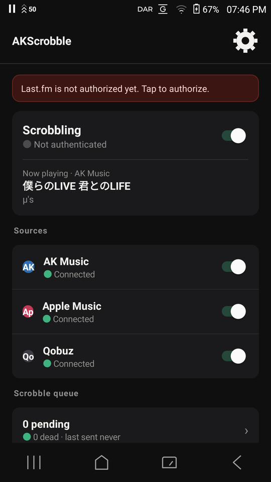
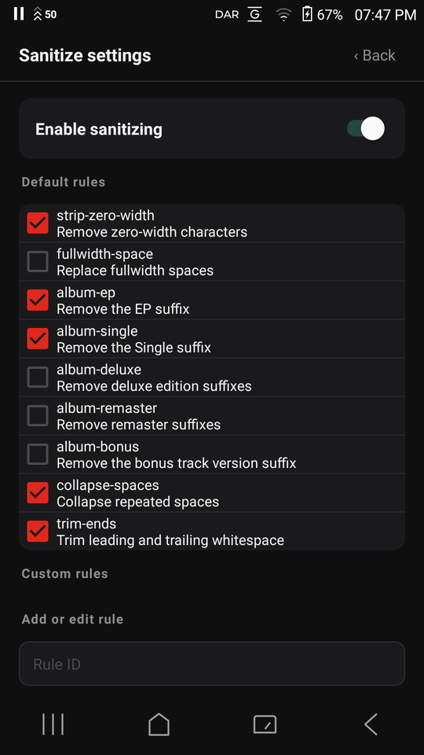
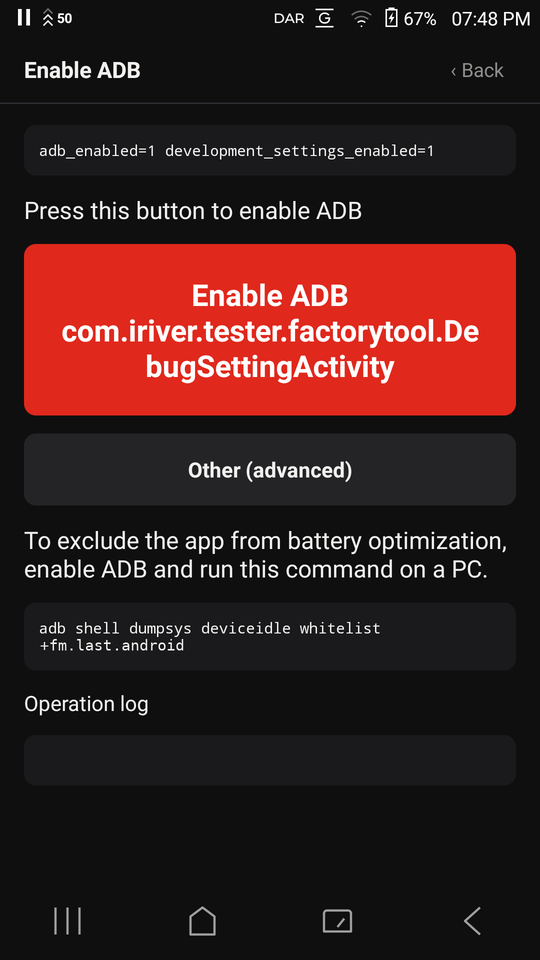

[English](README.md) | [日本語](README.ja.md) | [한국어](README.ko.md)

<p align="center"></p>

# AKScrobble

## What is this

AKScrobble is a Last.fm scrobbler for Astell&Kern digital audio players. It has
been tested on the A&ultima SP2000T running Android 9 and on the SP3000 series;
other Astell&Kern models have not been tested.

**No root is required.** Everything from installation to scrobbling works on a
stock device. Enabling ADB, which is needed for a single battery-optimization
command, is also done from inside the app.

The app uses the package name `fm.last.android` to satisfy the device firmware's
installation restrictions. See [Known limitations](#known-limitations) for the
consequences.

| Home screen | Title cleanup settings | Enable ADB |
|---|---|---|
|  |  |  |

Screenshots are from an SP2000T with the interface set to English.

### Why use it on an SP3000

AK Music leaves the album name out of the metadata it publishes, so a scrobbler
that only reads that metadata, such as Pano Scrobbler, cannot send the album.
AKScrobble looks the album up in MediaStore instead, so AK Music plays reach
Last.fm with the correct album.

## Supported players

The following players have been verified:

- AK Music (`com.iriver.ak.music`)
- Apple Music (`com.apple.android.music`)
- Qobuz (`com.qobuz.music`)

Amazon Music (`com.amazon.mp3`) cannot connect because its `onGetRoot` method
returns `null`. Spotify is untested and currently unsupported. If you need
support for it, or for another player, please [open an
issue](https://github.com/kakeru-ikeda/akscrobble/issues); support can be
considered based on demand.

Qobuz does not provide `ALBUM_ARTIST`, so tracks are sent without an album artist.

## What you need

- A Last.fm account
- A computer that can connect to the player over MTP

`adb` is needed for only one battery-optimization command. All other setup is
done on the player or through its MTP storage.

## Installation (from zero to scrobbling)

The file you install depends on the player's firmware:

- Astell&Kern firmware: install the `.xapk` through Open APP Service, as in
  steps 1 to 4 below.
- Full Android firmware (SP3000 series): install the `.apk` with any file
  explorer app on the player, as described next. This is a plain `.apk`, not
  the `.xapk`.

For full Android firmware, replace steps 1 to 4 with this, then continue from
step 5. The rest of the procedure is the same.

1. Download `akscrobble-<version>.apk` from [GitHub
   Releases](https://github.com/kakeru-ikeda/akscrobble/releases) onto the
   player, or copy it there over MTP.
2. Open a file explorer app on the player, tap the `.apk`, and install it. If
   Android asks, allow that file explorer to install apps.

For the Astell&Kern firmware, follow all of the steps below.

1. Download `akscrobble-<version>.xapk` from [GitHub
   Releases](https://github.com/kakeru-ikeda/akscrobble/releases).
2. Connect the player to your computer over MTP. Before copying anything,
   delete every old `.xapk` file and every extracted folder created by the
   player from the `OpenService` folder. Leftovers can cause duplicate entries
   and name collisions.
3. Copy the downloaded `.xapk` file into the `OpenService` folder.
4. On the player, open Open APP Service and install AKScrobble from the list.
   Open APP Service installs at most four applications; if the device has already
   reached that limit, uninstall one before installing AKScrobble.
5. Launch AKScrobble. The setup screen opens automatically.
6. Grant storage permission. AKScrobble needs it to retrieve AK Music album
   names from MediaStore.
7. In Setup, tap Continue to Last.fm. On the authentication screen, tap
   **Copy authorization URL**, paste it into a PC or another browser on the
   player, and approve access. Return to AKScrobble and tap **Get session**;
   setup resumes when authorization is complete.
8. Choose the source apps you want to scrobble, then finish setup to open Home.
9. Turn on **Scrobbling** on Home. AK Music, Apple Music, and Qobuz each have an
   individual switch and status. Status shows whether a source is Stopped, Not installed, Disabled, Connected,
   Connecting, or Not connected (will retry). Sources are enabled by default.
10. Exempt AKScrobble from battery optimization. This is the only step that
    requires a computer: open **Enable ADB** in the Home screen's Device section, then tap the highlighted `DebugSettingActivity`
    button to enable ADB. On the computer, confirm that
    the player appears in `adb devices`, then run:

    ```sh
    adb shell dumpsys deviceidle whitelist +fm.last.android
    ```

On the Astell&Kern firmware, do not try to open the `.apk` directly on the
player. That installation path is disabled, so it always ends with a package
parsing error; use the Open APP Service `.xapk` procedure above. This applies
only to the Astell&Kern firmware, not to full Android firmware.

## Updating from an older version

The first launch after updating requires Last.fm authorization again. Unsent scrobbles are kept and sent after you reauthorize. Saved API keys and secrets are removed. If storage permission is granted, the `api_key`, `api_secret`, and `session_key` lines are also removed automatically from `/sdcard/AKScrobble/config.properties`. Other lines are kept; if no meaningful content remains, the file is deleted.

## Self-updates

AKScrobble checks the update server for updates when it starts. If you accept an update,
the app downloads and installs it after checking the APK signature and SHA-256.
Self-updates are unlikely to work on AK firmware. If they fail, follow the
in-app instructions to download the `.xapk` from Releases and install it with
Open APP Service. The first version with self-update support must be installed
manually using the `.xapk` procedure above.

## About the signing service

The developer-operated [scrobsign](https://scrobsign.sukisuki.club) service
signs Last.fm requests (`api_sig`). Scrobble submissions go directly from the
player to Last.fm. To create a signature, scrobsign receives the session key
(`sk`) and track metadata such as artist, title, album, and playback time; it
does not store them. If the signing service is unavailable, a banner appears
on Home and unsent scrobbles are kept in the queue.

## Sanitize rules

AKScrobble can clean metadata before it is displayed, queued, and sent to
Last.fm. The built-in rules are:

| Rule ID | Scope | Default | Effect |
| --- | --- | --- | --- |
| `strip-zero-width` | ALL | ON | Remove zero-width characters. |
| `fullwidth-space` | ALL | OFF | Replace fullwidth spaces with regular spaces. |
| `album-ep` | ALBUM | ON | Remove a trailing ` - EP`. |
| `album-single` | ALBUM | ON | Remove a trailing ` - Single`. |
| `album-deluxe` | ALBUM | OFF | Remove a trailing parenthesized Deluxe edition label. |
| `album-remaster` | ALBUM | OFF | Remove a trailing parenthesized remaster label, optionally including a year or `Version`. |
| `album-bonus` | ALBUM | OFF | Remove a trailing `(Bonus Track Version)`. |
| `collapse-spaces` | ALL | ON | Collapse repeated spaces or tabs into one space. |
| `trim-ends` | ALL | ON | Remove leading and trailing whitespace. |

Open **Title cleanup (sanitize)** in Settings to enable or disable the built-in rules. To add a custom
rule, provide a unique ID, choose its scope (`ALL`, `TRACK`, `ARTIST`, `ALBUM`,
or `ALBUM_ARTIST`), enter a regular expression and replacement string, then
save it. Use the preview fields to try sample metadata and inspect each change
before relying on the rule.

As a safety measure, if a replacement would leave a value containing only
whitespace, AKScrobble keeps the original value.

## How scrobbling works (for developers)

AKScrobble connects to each target app's `MediaBrowserService` with
`MediaBrowser`, without requiring a permission, and subscribes to metadata and
playback-state updates through `MediaController`. It does not use a
`NotificationListenerService`, which the AK firmware rejects through internal
state and would require root access to work around. It also does not use
`MediaSessionManager.getActiveSessions()`, which requires privileged access.

Playback time is accumulated against a monotonic clock instead of trusting
`PlaybackState.position`; AK Music can report `position = -1` immediately after
its session becomes active. A track is scrobbled after either 50% of its duration
or four minutes (`Const.SCROBBLE_CAP_MS`), whichever comes first. Tracks shorter
than 30 seconds (`Const.SCROBBLE_MIN_DURATION_MS`) are not scrobbled.

AK Music omits the album name from its metadata, so AKScrobble resolves it from
MediaStore. A literal `<unknown>` returned by MediaStore is converted to `null`;
otherwise Last.fm rejects the entire scrobble with ignored code 1. Metadata is
sanitized before it is placed in the SQLite queue. The queue drains when network
connectivity returns and every five minutes. Transient failures are retried with
backoff, while permanently rejected items are marked `dead`.

To add a player, add `{package name, fully qualified MediaBrowserService class
name}` to `TARGETS` in
`scrobbler/src/com/akscrobble/core/Const.java`. Find the service name with:

```sh
adb shell dumpsys package <package>
```

This works only if the target app's `onGetRoot` accepts the connection; Amazon
Music rejects it. If you get an unsupported app working locally, please
[open an issue](https://github.com/kakeru-ikeda/akscrobble/issues) or send a
[Pull Request](https://github.com/kakeru-ikeda/akscrobble/pulls).

## Troubleshooting

### AKScrobble does not appear in the installation list

Check the player's `OpenService` folder for older `.xapk` files and folders that
the player extracted previously. Delete those leftovers, copy only the current
`.xapk` into the folder, and reopen Open APP Service.

### The player says there was a problem parsing the package

Check whether you tried to open an `.apk` directly on the Astell&Kern firmware.
That firmware disables the installation route. Download the `.xapk` release and
install it through Open APP Service as described above. On full Android
firmware, the `.apk` installs normally from a file explorer.

### Last.fm authentication fails

If the Home banner says Signing service unavailable, wait and try again
later; unsent scrobbles remain queued. If it says Last.fm service problem,
wait for Last.fm to recover. If either banner persists, report it in the
[issue tracker](https://github.com/kakeru-ikeda/akscrobble/issues).

### Tracks are not scrobbled

Open the app and check the service status, current track, elapsed time, supported
player, network connection, and battery-optimization exemption. Tracks under 30
seconds are intentionally skipped. If the current track never appears, confirm
that you are using a supported player and restart the service.

For a fuller snapshot, open Settings and tap **Save diagnostic dump**. AKScrobble writes
`/storage/emulated/0/AKScrobble/diag-*.txt` containing `STATUS`, `PREFS`, `QUEUE`,
and `DEVICE` sections. The `session_key` and `session_api_key` values in `PREFS` are
masked as `***`; review the file before attaching it to an issue.

### Queue entries become dead

Open the Scrobble queue row on Home (or **Scrobble queue** in Settings) and inspect the recorded error. A `dead` entry was permanently
rejected rather than delayed by a temporary network failure. Correct invalid
credentials or metadata as indicated by the error, then retry or delete the dead
entries from the queue screen. A diagnostic dump can provide the queue counts
and surrounding state when reporting the problem.

## Building from source

Normal releases use release-please. Conventional Commits such as `feat:` and
`fix:` on `main` update a release PR. Merge that PR to build and sign the APK
and XAPK, verify the signing certificate, attach both assets to the GitHub
Release, and register the APK with the update server. Promote a release to `stable`
manually in the update server's admin UI.

For an emergency local release, install the Android SDK and run the existing
release script. Release artifacts must be signed with an explicitly provided
key. The dev keystore that `tools/env.sh` falls back to has its password
committed to this repository, so it must never sign anything you distribute.
Keep the release key and use it for every release:

```sh
./tools/fetch_sdk.sh
export AKS_KEYSTORE=/secure/path/akscrobble-release.keystore
export AKS_KS_PASS='<your release keystore password>'
./build/make_release.sh 1000002 1.0.2
./verify/run_all.sh
```

`make_release.sh` refuses to run if either variable is unset, and prints the
`keytool` command to create the keystore if it does not exist yet. Changing the
signing key later breaks updates for everyone who already installed the app.
The build does not use Gradle or Android Studio. Its scripts invoke `aapt2`,
`javac`, `d8`, `zipalign`, and `apksigner` directly, and the launcher icon
resources in `scrobbler/res` are compiled with `aapt2`. APKs are signed with v1
and v2 signatures only because the AK firmware does not accept v3 signatures.

## Known limitations

- The package name `fm.last.android` is borrowed because the AK firmware's
  installation whitelist permits only listed package names. AKScrobble therefore
  cannot coexist with the official Last.fm app.
- An APK signed with a different key cannot update an existing installation; the
  old installation must be uninstalled once before installing it. Uninstalling
  clears more than the app itself, as measured on an SP2000T:
  - The Last.fm session is lost, so authentication has to be repeated.
  - The device drops the package from its doze whitelist, so
    `adb shell dumpsys deviceidle whitelist +fm.last.android` has to be run
    again.
  - Storage permission, the language setting, and any sanitize rules are reset.
  - Unsent queue entries are lost, so send them before uninstalling.
- AK Music, Apple Music, and Qobuz are currently supported.
- `ScrobbleDb.onUpgrade` drops its tables, so an update that changes the database
  schema erases any unsent queue entries.

## License and disclaimer

AKScrobble is released under the MIT License. It is not affiliated with,
endorsed by, or an official application of Last.fm. The package name
`fm.last.android` is borrowed solely to satisfy the AK firmware's installation
restrictions.

## Other Astell&Kern models

AKScrobble has been verified on the SP2000T and the SP3000 series. Its
behavior is the same on both. The SP4000 series has not been tested.

If you want a more capable scrobbler and are willing to obtain ADB access, see
[PPPPatrick0's Astell&Kern DAP Root Guide](https://github.com/PPPPatrick0/AstellKern-DAP-Root-Guide) and
[Pano Scrobbler](https://github.com/kawaiiDango/pano-scrobbler). Keep in mind
that Pano Scrobbler cannot read AK Music's album information; see [Why use it
on an SP3000](#why-use-it-on-an-sp3000).

## Special thanks

- [PPPPatrick0](https://github.com/PPPPatrick0/AstellKern-DAP-Root-Guide) for the Astell&Kern DAP root guide, which documents the
  ADB access path that this project's investigation started from.

For device-specific findings and constraints, see
[Device notes](docs/DEVICE-NOTES.md).
